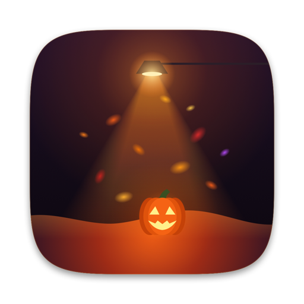

<p align="center">
  
</p>

<h1 align="center">Spookhush 🎃🍂</h1>

<p align="center">It's haunted on your desktop.</p>

<p align="center">
  <a href="https://github.com/andre-stana/Spookhush/releases/latest/download/Spookhush.dmg"><b>Download for macOS (.dmg)</b></a>
  &nbsp;·&nbsp;
  <a href="https://github.com/andre-stana/Spookhush/releases/latest/download/Spookhush-Setup.exe"><b>Download for Windows (.exe)</b></a>
  &nbsp;·&nbsp;
  <a href="https://github.com/andre-stana/Spookhush">GitHub</a>
  <br>
  <sub>macOS 14 or later · Windows 10 or 11 · WebGL2 interactive demo · free and open source</sub>
</p>

A tiny Halloween & autumn ambiance app that lives in the menu bar on macOS (with a custom Jack-o'-lantern icon) and in the system tray on Windows. Autumn leaves, glowing embers, spectral sparks, and carved mini Jack-o'-lantern pumpkins drift across your screen, pile up along the tops of your windows and Dock, and tumble off when you drag or shake them. Sweep the leaf drifts aside with your cursor lantern, and listen to subtle procedural leaf rustles, ember crackles, and eerie wind gusts.

> **Credits & Attribution**: **Spookhush** is an open-source Halloween adaptation of **[Snowhush](https://github.com/mbezruchko/Snowhush)**, originally created by **[Mykhailo Bezruchko](https://github.com/mbezruchko)** under the [MIT License](LICENSE). All credit for the original granular drift physics engine, window ledge tracking, and ultra-lightweight architecture goes to Mykhailo Bezruchko.

---

## What Spookhush does

- **Falls.** Autumn leaves (crimson maple, pumpkin orange, golden amber, and russet), glowing fiery embers, violet spectral sparks, and carved mini Jack-o'-lanterns drift and tumble in a slow breeze. **Variable** lets the autumn fall rise and ease on its own.
- **Settles & Glows.** Leaves and ash pile up and slump to a natural slope along the bottom of the screen, on any window with room above it, and on the Dock. Deep leaf drifts reveal smoldering embers and nestled glowing Jack-o'-lanterns with flickering candle halos.
- **Moves.** Push your cursor through a leaf pile and it parts and sprays autumn leaves and sparks. Drag or shake a window and its leaves slide off and land below.
- **Drops.** Close or minimize a window and its leaves drop at once in clumps and mini pumpkins that burst into autumn dust and embers where they land.
- **Lantern Light.** With **Lantern Light** on, your cursor casts a warm flickering Jack-o'-lantern candle glow onto nearby leaf piles and falling particles.
- **Procedural Sound Effects.** With **Sound Effects** on, sweeping through leaf piles triggers real-time synthesized dry leaf rustling and ember crackles (zero external audio files, 100% procedural synthesis via `AVAudioEngine` on macOS and Web Audio API on the web), falling clumps land with a hollow pumpkin thud, and clearing the screen summons an eerie Halloween wind howl.
- **Fades.** With **Fade Leaves** on, the leaf drift slowly settles and fades so it never takes over your screen.
- **Hides & Rests.** Screenshots and screen sharing show your desktop without it unless you turn on **Show in Screenshots**. Uses minimal CPU/GPU and pauses while your screen sleeps, locks, or is covered.

Everything lives in the menu bar: **Autumn Fall** (`Off`, `Light`, `Steady`, `Heavy`, `Variable`), **Accumulate**, **Fade Leaves**, **Leaves on Windows**, **Clear Leaves**, **Lantern Light**, **Sound Effects**, **Behind Windows**, **Show in Screenshots**, and **Open at Login**.

---

## Building & Running

### macOS (Native Metal + AppKit + AVAudioEngine)

```sh
./build.sh            # Builds build/Spookhush.app, signed ad hoc
open build/Spookhush.app
```

### Interactive Web Demo (`site/`)

Open `site/index.html` or serve `site/` locally to try the full interactive WebGL2 + Web Audio API desktop simulation directly in your browser:

```sh
python3 -m http.server 8080 --directory site
```

### Windows (Rust + Direct3D 11)

```sh
windows/build.sh      # Cross-compiled from macOS
```

---

## Credits & License

- **Original Project**: [Snowhush](https://github.com/mbezruchko/Snowhush) by [Mykhailo Bezruchko](https://github.com/mbezruchko)
- **Halloween Adaptation (Spookhush)**: Autumn leaf / Jack-o'-lantern / ember shaders, cursor lantern lighting, and procedural Halloween sound synthesizer.
- Licensed under the [MIT License](LICENSE).
